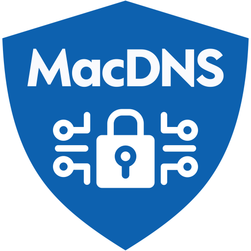
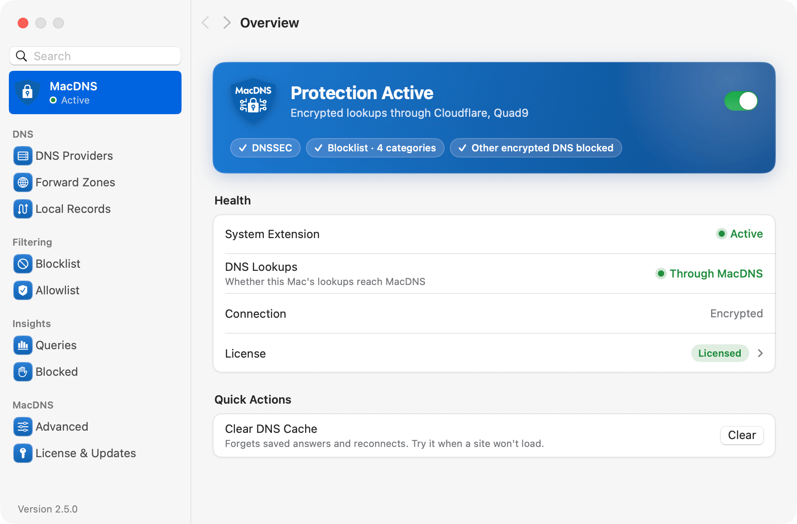

  

<h1 align="center">MacDNS</h1>

  Encrypted DNS and blocklists for every app on your Mac, from the menu bar.

  
  
  

  

MacDNS handles every DNS lookup on your Mac through a macOS network extension. It sends them encrypted over DNS over HTTPS, blocks ads, trackers and malware before a connection starts, and answers repeated lookups from a local cache. It works for every app, including the ones that ignore proxy settings.

## Features

### Encrypted lookups

- Lookups go over DNS over HTTPS to Cloudflare, Google or Quad9 instead of the plaintext DNS server of the network you are on. Pick one or more providers in Settings.
- **Query Mode** decides how MacDNS uses more than one provider: ask all of them at once and take the first answer, ask the next one after a short delay, or ask them in order.
- **DNSSEC Validation** asks the provider to check signed answers and discard the ones whose signature fails.
- **Block Other Encrypted DNS** stops apps that send their own encrypted DNS and skip your blocklists. It blocks DNS over TLS and DNS over QUIC, and DNS over HTTPS to well-known providers. It is off by default.

### Blocklists

- Six categories: Ads & Tracking, Malware & Security, Adult Content, Gambling, Social Media and Miscellaneous (pop-ups, link shorteners and services apps use to get around DNS filtering).
- Each category has its own level, from Light to Ultimate, so you choose how strict it is.
- The lists update in the background. A list change takes effect without restarting anything.
- The **Allowlist** unblocks a domain that a list blocks by mistake.
- The **Blocked** page shows what was blocked, by which category, and lets you allow a domain from there.

### Your own DNS rules

- **Local Records** answer a name with the address you choose, for a dev server or a device on your network. They also block a single domain.
- **Forward Zones** send a domain to a DNS server you name, such as `corp.example.com` to the company's internal server.
- Names that only make sense on your network, like `.local`, reverse lookups for private addresses and the search domain your router hands out, keep going to the network's own DNS server.

### Speed

- Answers are cached on your Mac. **Prefetch** renews the answers you used in the last few hours before they expire, and **Serve Expired** reuses an older answer when the providers are slow or unreachable.
- **Keep Popular Hosts Fresh** keeps the hosts you look up most often ready in the cache, so they answer with no network wait.
- **Clear DNS Cache** in the menu bar forgets saved answers when a site won't load.

### Insights

- The **Queries** page shows how many lookups your Mac made, how many were blocked or answered from the cache, the response time, and your most looked-up hosts.
- Lookup history is stored only on this Mac. You choose how many days it keeps, can turn it off, and can delete it at any time.

### Works on any network

- **Wi-Fi sign-in.** When a hotel or airport Wi-Fi needs you to sign in, MacDNS sends lookups to the network's DNS server long enough to load the sign-in page, with blocklists still on. If the page still won't load, you can allow a full bypass for that network. It ends after 15 minutes.
- **DNS rebinding defense.** A public name that answers with a private address, like your router's, is refused, so a web page can't use DNS to reach devices on your network.
- **IPv6-only networks.** On networks that translate IPv6 to IPv4, such as an iPhone hotspot, sites that only have an IPv4 address still work.

### Privacy

Your lookups, history and settings stay on your Mac. MacDNS connects only to the DNS providers you pick, to download blocklists, to check your license and to check for updates.

## Installation

1. Download `MacDNS.dmg` from the [latest release](https://github.com/MacDNS-app/macdns/releases/latest).
2. Open it and drag MacDNS to Applications.
3. Open MacDNS from Applications. The setup window walks you through each macOS request:
   - **Turn On** installs the background service and starts your free trial.
   - **Allow the network extension** in System Settings. On macOS 15 and later it is under Network Extensions. On macOS 14 click Allow under Privacy & Security.
   - **Allow DNS filtering** when macOS asks whether MacDNS can filter network content.
   - **Allow notifications** so MacDNS can remind you before the trial ends and tell you when an update needs a restart.

   If macOS asks to let MacDNS find devices on your local network, click Allow so local names and Wi-Fi sign-in pages keep working.
4. The shield in the menu bar shows that protection is on. Click it to turn protection on or off, change providers, toggle options or open Settings.

MacDNS checks for updates on its own and asks before installing one.

The 21-day free trial needs no registration and no card. To keep using MacDNS after it, buy a license at [macdns.app](https://macdns.app) and paste the key under License & Updates in Settings.

### Uninstall

Open Settings, go to Advanced and click **Uninstall MacDNS**. It removes the background service and the extensions. macOS may ask you to restart to finish.

## Requirements

- macOS 14 Sonoma or later
- Apple Silicon or Intel Mac

## Reporting issues

Found a bug? [Open an issue](https://github.com/MacDNS-app/macdns/issues/new/choose). The template lists the diagnostic information to include.

## Support

- Email: support@macdns.app
- Website: [macdns.app](https://macdns.app)

## License

The source code is available under the [Fair Core License 1.0](LICENSE), with Apache 2.0 as the future license. Each version becomes Apache 2.0 two years after its release. Using the app needs a license, see the [Terms of Use](https://macdns.app/terms).

Each license is valid for up to 2 Macs. 30-day money-back guarantee.

Outside contributions are not accepted at this time.

© 2025-2026 Marcus Grando
